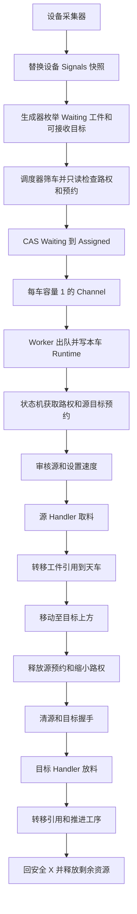

# 文档与源码分析报告（2026-10-08）

## 1. 结论与证据范围

已先阅读 Docs 下全部 11 份 Markdown 文档，再核对领域模型、应用层流程、真实通信驱动、配置加载、界面入口及测试。当前架构主干与文档一致，主要问题集中在通信故障分类、执行循环存活、运动保护、任务状态并发和配置生命周期。

通信超时导致 Worker 永久退出的问题已按用户授权修复，详见问题 1 的后续处理。其余优先问题：X2 读取失败放行、运动轮询忽略报警、源握手复位与新任务交错、任务暂停/删除与派发竞争、斜床零偏移被真实驱动拒绝、冷启动有板天车仍能被派发。

证据分为：
- **本机复现**：编译原 ModbusTcpClient.cs，在回环地址使用不回复的 TCP 服务复现内部通信超时误抛取消异常。
- **源码确认**：代码路径、条件与异常传播可直接确认；涉及并发时，仅确认存在交错窗口，未声称已在现场发生。
- **现场待确认**：物理布局、PLC 联锁、反馈能力和文本字节顺序，不能仅凭上位机源码判断。

P1 表示建议优先修复的执行或保护问题；P2 表示后续应处理的一致性、恢复或性能问题。优先级是本次分析建议。

分析阶段未修改业务源码。随后用户授权实施问题 1 的修复、更新文档并提交 Git；本报告保留原始问题证据并增加修复记录。全过程未启动主程序、未连接现场 PLC 或数据库。

## 2. 文档基线与实际架构

### 2.1 分层职责

| 层 | 实际职责 | 分析结论 |
| --- | --- | --- |
| Domain | 工件/天车/设备运行态、工艺路线、信号快照、空间区间 | 基本独立；运行态由多个线程访问，单点 CAS 未覆盖所有状态修改 |
| Application | 采集、候选生成、调度、预约、路权、执行流程、报警协调 | 主流程清楚，Handler 隔离设备差异；执行期故障分类和状态协调需要加强 |
| Infrastructure | Modbus/FOCAS、真实驱动、MySQL 配置、日志 | 通信已接真实实现；现有单元测试未覆盖该层 |
| Focas | FANUC SDK 包装和原生 DLL | 专用线程串行化调用；连接失效和取消语义存在缺口 |
| Ui | WPF、页面 ViewModel、Generic Host 装配 | 页面刷新与任务控制可能和执行线程竞争 |

技术栈为 .NET 8、WPF、CommunityToolkit、Generic Host、EF Core/MySQL。FOCAS 原生依赖与项目按 x86 配置。数据库主要保存天车、设备配置，工件任务和报警保存在内存。

### 2.2 实际执行链



派发真正使用 Channel，调度器不直接赋值 Crane.Runtime；资源竞争发生在状态机入口，失败回滚 Waiting。依据：[调度与 CAS](D:/BSH/c#/code/AutomatedLine/src/AutomatedLine.Application/Scheduling/CraneScheduler.cs:270)、[Worker 出队](D:/BSH/c#/code/AutomatedLine/src/AutomatedLine.Application/Workers/CraneWorker.cs:123)、[流程入口与 Acquire](D:/BSH/c#/code/AutomatedLine/src/AutomatedLine.Application/Workers/CraneStateMachine.cs:95)。

默认路线：上料 → 双头镗 → 斜床 → 研磨 → 动平衡 → 打号 → 验点 → 下料。工序是否参与只看是否有启用设备；没有则跳过，已启用但离线则等待。货叉不在默认路线中。依据：[ProcessRoute](D:/BSH/c#/code/AutomatedLine/src/AutomatedLine.Domain/Routing/ProcessRoute.cs:37)。

### 2.3 坐标与握手核对

设备目标坐标由数据库 XYZ 加本车偏移产生；安全坐标直接使用天车配置。每次搬运的上下文首次需要坐标时读取设备配置列表并缓存，不是每一步都查库。斜床/研磨下压量按直径的一半计算，其余设备采用文档中的 0.9537/0.866 系数。斜床 Y 二次偏移按每台设备的 JSON 参数计算。

六种已接入 Handler 的主要流程和点位与设备文档相符：
- 双头镗/研磨使用 R×2+1 的 0 基地址。
- 打号状态使用 FC04；文档 1 基地址转换为 PDU 地址时减 1；外径实际下发 Diameter，内径下发 PlugHole。
- 料架使用端口 10000、站号 254、FC02，输入 bit0/bit1。
- 斜床使用 FOCAS、8193 端口；加工模式来自录入值。
- 天车 X 区八进制换算正确，X11 对应 63497。

这是文档与代码的一致性核对，不等同于 PLC 联调验收。打印文本字节顺序、点位可用性和物理确认仍需现场验证。

### 2.4 已明确的设计边界

以下属于已有约定，不能单独当作遗漏功能：
- 工件任务不落库，程序退出后消失。
- 手动操作不与自动流程互斥。
- 安全位空驶不纳入当前搬运路权区间，依赖现场布局保证。
- 配置变更需要停线、修改、关闭程序后重新启动；生产环境不支持完整热重载。
- 当前没有预约超时回收和 Assigned 自动恢复机制。

但“暂停后仍有在途流程”和“页面在重启前主动重载配置”的组合仍产生风险，详见问题 8。

## 3. 优先问题

### 1）P1：通信超时被误认为调用者取消，导致天车 Worker 永久退出（已修复）

以下触发条件、原始异常链和本机复现均记录修复前行为；当前实现见本节后续处理，源码修复提交为 `1918cf4`。

**触发**：请求发出后 PLC 未在通信期限内返回。

**依据**：[ExchangeAsync](D:/BSH/c#/code/AutomatedLine/src/AutomatedLine.Infrastructure/Communication/ModbusTcpClient.cs:322) 使用 linked.CancelAfter，读写超时后保留 OperationCanceledException。运动驱动原样重抛该异常；[状态机取消分支](D:/BSH/c#/code/AutomatedLine/src/AutomatedLine.Application/Workers/CraneStateMachine.cs:164) Abort 后重抛；[Worker 取消分支](D:/BSH/c#/code/AutomatedLine/src/AutomatedLine.Application/Workers/CraneWorker.cs:133) 再次清理后重抛，退出整个车循环。循环仅在 StartAsync 创建，没有运行期监督或重建。[启动线路](D:/BSH/c#/code/AutomatedLine/src/AutomatedLine.Application/Line/LineControlService.cs:41) 仅修改线路状态。

**本机复现**：
```text
Exception=OperationCanceledException
CallerCancellationRequested=False
ElapsedMs=213
ConnectedAfterTimeout=False
TimeoutMisclassifiedAsCancellation=True
```

诊断设置 200ms 通信超时，调用者令牌为 None。已复现的是驱动异常分类；Worker 退出结论来自上述调用链，未进行现场复现。

**影响**：一次超时可使对应天车不再消费后续任务；重新点击启动线路不能恢复这个循环。Worker 的 StopAsync 只 WhenAny，没有观察循环最终异常，进一步降低故障可见性。

**后续处理（2026-10-08）**：`ExchangeAsync` 已覆盖自动连接、发送和响应读取，内部超时断开连接并转为 `TimeoutException`；调用者真正取消保留 `OperationCanceledException`。状态机与 Worker 的取消分支均增加执行器令牌过滤器，非调用者取消按普通故障处理。

**业务结果**：当前板仍标记为 Discarded、释放资源、故障暂停；人工处理并恢复线路后，同一天车继续消费新任务，不重试已丢弃板。真正停止执行器仍退出循环。

**回归证据**：新增 8 个定向用例；旧实现 5 失败、3 通过，修改后 8/8 通过。覆盖真实客户端的自动/显式连接后超时及重连、调用者取消，真实 Worker 的流程内/入口异常后下一单，以及状态机真正取消与停机清理。

**范围**：未新增 Worker 循环监督/自动重建，StopAsync 仍使用 WhenAny；这些运行监督边界不纳入本次修复。

### 2）P1：X2 下压保护读失败按“未触发”继续

**依据**：[IsPressureLimitOnAsync](D:/BSH/c#/code/AutomatedLine/src/AutomatedLine.Infrastructure/Communication/CraneService.cs:843) 捕获所有 Exception，日志后返回 false；[运动轮询](D:/BSH/c#/code/AutomatedLine/src/AutomatedLine.Infrastructure/Communication/CraneService.cs:810) 只在 true 时执行下压停止。

**触发与影响**：FC01/X2 读失败而位置寄存器读取仍成功时，后续位置读取不能保证兜底。软件把保护信号未知当作未触发，可能继续下降或返回到位。catch 还吞掉取消异常。

源码注释说明这是为避免误急停而作出的选择，但“下一次位置读取一定能检测通信中断”的前提并不成立：连接可重连，或仅某个点位/功能读取被拒绝。此处需要明确未知状态策略。

**建议**：让 X2 结果区分成功、未触发、读取失败；未知时停止当前动作并返回保护状态不可用，保留取消语义。具体停止动作与 PLC 联锁需现场共同确认。本次未证明物理碰撞或 PLC 自身保护失效。

### 3）P1：运动轮询读取了报警，却不参与成功/失败判断

**依据**：[原始状态读取](D:/BSH/c#/code/AutomatedLine/src/AutomatedLine.Infrastructure/Communication/CraneService.cs:178) 获得 ServoAlarm、PlcServoAlarm、PlcAlarm；[PollAxesAsync](D:/BSH/c#/code/AutomatedLine/src/AutomatedLine.Infrastructure/Communication/CraneService.cs:794) 只判断坐标、X2 和期限。

**影响**：运动中报警出现时，坐标落在容差内仍能返回 InPosition，否则可能一直等运动超时。TransferContext.WaitCraneAsync 虽检查 HasAlarm，但只在明确调用该等待函数时执行，不能覆盖所有移动过程。

**建议**：每次状态读取后按现场报警定义判断并返回失败；与下压工艺急停/清报警流程协调判断顺序，避免把正常下压收尾误归类。

### 4）P1：源预约先释放，再复位源握手，可能擦掉下一任务的信号

**依据**：[TransitAsync](D:/BSH/c#/code/AutomatedLine/src/AutomatedLine.Application/Workers/CraneStateMachine.cs:272) 先 ReleaseSource、Resize，再在后续 await 中清源握手。

**可成立的交错**：
1. A 到目标后释放原源设备 S 的预约并缩小路权。
2. B 将 S 作为新目标，获得预约，开始清旧位和发送新参数/握手。
3. A 继续清 S 的握手，把 B 本轮已写的位重新写 0。

**影响**：新一轮数据完成、上料到位等电平可能被旧任务清掉，造成等待超时或 PLC 漏接。单个连接按请求串行并不等于整个握手序列按任务串行。

**建议**：在仍持有 S 预约时完成源握手复位，再释放；如保留部分释放策略，明确握手清理的任务归属。用两任务的可控屏障测试验证。该并发窗口由源码确认，未在现场复现。

### 5）P1：任务暂停/删除没有与派发形成同一个原子状态协议

**依据**：
- [Pause](D:/BSH/c#/code/AutomatedLine/src/AutomatedLine.Application/Runtime/RuntimeTaskManager.cs:104) 在自身锁内检查 Waiting，再普通写 Paused；调度器的 CAS 不使用同一把锁。
- [Remove](D:/BSH/c#/code/AutomatedLine/src/AutomatedLine.Application/Runtime/RuntimeTaskManager.cs:62) 直接删除，服务层不检查状态。
- [ClearTask](D:/BSH/c#/code/AutomatedLine/src/AutomatedLine.Ui/ViewModels/MainViewModel.cs:190) 依据界面 CanClear 缓存清设备/天车引用后删除；[CanClear 刷新](D:/BSH/c#/code/AutomatedLine/src/AutomatedLine.Ui/ViewModels/WorkpieceTaskViewModel.cs:152) 来自定时刷新。

**交错与影响**：Pause 检查通过后，调度 CAS 成功入队，随后 Pause 将 Assigned/Running 覆盖为 Paused；或者界面还显示可清除时任务刚被派发，ClearTask 将任务和引用删除，Worker 仍持有搬运任务。表现可能包括找不到工件、运行态错误和引用被清空。

**建议**：派发、暂停、删除使用统一受保护的状态迁移入口，协调状态和 QueueOrder；清引用必须发生在删除资格原子取得后。单纯在 UI 再检查一次仍无法关闭竞态窗口。

### 6）P1：斜床 YOffset=0 仍调用零相对移动，真实驱动拒绝

**依据**：[斜床偏移缺省](D:/BSH/c#/code/AutomatedLine/src/AutomatedLine.Application/Transfer/Handlers/LatheHandler.cs:117) 缺少本台配置时返回 0；[取料二次移动](D:/BSH/c#/code/AutomatedLine/src/AutomatedLine.Application/Transfer/Handlers/LatheHandler.cs:57)、[放料二次移动](D:/BSH/c#/code/AutomatedLine/src/AutomatedLine.Application/Transfer/Handlers/LatheHandler.cs:97) 均无零值分支。[真实 MoveRelativeAsync](D:/BSH/c#/code/AutomatedLine/src/AutomatedLine.Infrastructure/Communication/CraneService.cs:309) 对 (0,0,0) 返回 Rejected。

**触发**：配置缺失，或者合法参数公式四舍五入得到 0。

**影响**：流程会被拒绝并弃板；取料分支已完成充磁、等待尾座张开后才遇到零移动，不能当作无副作用参数错误。[FakeCraneDriver](D:/BSH/c#/code/AutomatedLine/tests/AutomatedLine.Tests/Fakes/FakeCraneDriver.cs:44) 始终返回成功，所以现有流程测试掩盖了真/假驱动的契约差异。

**建议**：进入自动运行前验证启用斜床配置完整性；合法零偏移跳过二次移动；假驱动应覆盖真实驱动的拒绝条件，增加缺配置和零偏移测试。

### 7）P1：冷启动检测到有板天车仅报警，实际仍允许派发

**依据**：[冷启动告警](D:/BSH/c#/code/AutomatedLine/src/AutomatedLine.Application/Line/ColdStartChecker.cs:68) 提示“将不参与调度”；[天车筛选](D:/BSH/c#/code/AutomatedLine/src/AutomatedLine.Application/Scheduling/CraneScheduler.cs:224) 只检查启用、空闲、覆盖范围、状态可读、无报警，不排除 HasPlate=true。状态机入口也没有无板预检。

**影响**：未关联内存工件的残留板不会自行生成搬运任务，但同一台天车仍可能接到另一工件的取料任务。提示的隔离效果没有实现。

**建议**：建立现场/内存不一致的明确阻塞状态；无关联工件时 HasPlate=true 应排除新取料，并确定 HasPlate 未知的策略。人工处理完成后再解除阻塞。

## 4. 后续问题与明确行为

### 8）P2：暂停只阻止新任务出队，配置页仍可在在途搬运时重载

[Worker 线路门控](D:/BSH/c#/code/AutomatedLine/src/AutomatedLine.Application/Workers/CraneWorker.cs:123) 只在出队前检查 IsRunning，随后一次 await 跑完整流程；人为暂停和故障暂停均不取消其他在途任务。Abort 做逻辑清理和故障暂停，不能等同于向所有 PLC 发物理停止命令。

[天车页修改门控](D:/BSH/c#/code/AutomatedLine/src/AutomatedLine.Ui/ViewModels/CraneViewModel.cs:59) 与设备页只检查 !IsRunning。因此暂停后即使还有天车搬运，页面也允许保存并调用配置重载。

[LoadAsync](D:/BSH/c#/code/AutomatedLine/src/AutomatedLine.Infrastructure/Config/ConfigurationLoader.cs:72) 先清注册表/驱动/Channel，再读库：
- Worker 仍捕获旧 Crane 和旧 Channel，执行中上下文却可能取新驱动。
- 新增/重新启用天车没有新 Worker。
- Channel 被清空后 Assigned 没有自动回收；界面也不允许删除 Assigned，不能依赖“人工删除”恢复。
- 后续查库失败时，原可用注册表已被清空。
- [DriverRegistry.Clear](D:/BSH/c#/code/AutomatedLine/src/AutomatedLine.Application/Runtime/DriverRegistry.cs:23) 只清字典，未处置旧驱动/FOCAS 线程与连接。

一般热重载问题已在[配置变更规程](D:/BSH/c#/code/AutomatedLine/Docs/架构设计文档.md:1516)披露。本次补充的是：仅点击暂停不足以保证修改时没有在途流程，即便计划改完立即重启也存在重启前的窗口。

建议配置页要求执行任务归零后再变更；生产模式可只保存下次启动配置，避免当场重载。若要支持热重载，需完整停止/重建 Worker、驱动及运行态，并先构造验证新配置后再切换。

### 9）P2：大屏未打开也读天车，刷新允许重入

[大屏构造订阅](D:/BSH/c#/code/AutomatedLine/src/AutomatedLine.Ui/ViewModels/ScreenViewModel.cs:85) 永久订阅每秒 Tick 并 fire-and-forget 调用 RefreshAsync；[Shell 注入大屏](D:/BSH/c#/code/AutomatedLine/src/AutomatedLine.Ui/ViewModels/ShellViewModel.cs:40) 在初始显示主页面时已构造大屏 ViewModel。切页只改 CurrentPage，没有激活/停用通知。

RefreshAsync 顺序 await 全部天车状态，未设置忙标志。一次读取超过 1 秒时，下次 Tick 再入；多个刷新排队占用真实驱动的连接锁，与自动运动/调度读取竞争。

建议仅在页面激活时读取，并限制同时只有一个刷新；离开页面取消等待。文档[大屏按需读取约定](D:/BSH/c#/code/AutomatedLine/Docs/页面布局/大屏展示页面.md:45)需与实现同步。

### 10）P2：信号未知、质量和新鲜度没有形成完整判据

[SignalSnapshot.GetBool](D:/BSH/c#/code/AutomatedLine/src/AutomatedLine.Domain/Signals/SignalSnapshot.cs:27) 将缺失或非 bool 视作 false；[CanReceive](D:/BSH/c#/code/AutomatedLine/src/AutomatedLine.Application/Generation/DeviceHandshakeRules.cs:53) 对打号 Busy、下料架 HasMaterial 取反，已连接但缺点位的快照可能被当作可接收。

生成器另有[连接筛选](D:/BSH/c#/code/AutomatedLine/src/AutomatedLine.Application/Generation/TransportTaskGenerator.cs:260)，因此普通断开空快照会被挡住，不能概括成“断开就能接料”。

[WaitDeviceAsync](D:/BSH/c#/code/AutomatedLine/src/AutomatedLine.Application/Transfer/TransferContext.cs:209) 检查键存在，却把非 bool 值算成 false；expected=false 时可满足。没有验证连接、质量、CapturedAt 或 Sequence。目前真实驱动正常输出 bool，这一类型缺口主要涉及异常快照和未来驱动扩展。

[采集统一发布](D:/BSH/c#/code/AutomatedLine/src/AutomatedLine.Application/Collection/DeviceStateCollector.cs:178) 等所有设备 WhenAll 后一起发布；一个慢设备会推迟健康设备的新快照，旧信号没有统一过期判定。对于已成立的旧握手，也未要求本轮写入后出现新的采样/反馈。

建议提供严格布尔读取、质量与有效期策略；按设备发布整体快照，避免全线被一个慢设备拖延。是否需要“写入后新版本/新边沿”应结合 PLC 握手协议确定。

### 11）P2：脉冲命令中途取消可能留下触发寄存器=2

[PulseAsync](D:/BSH/c#/code/AutomatedLine/src/AutomatedLine.Infrastructure/Communication/CraneService.cs:696) 写 2 → 可取消延时 → 写 0，无 finally；PulseManyAsync 同类。[PulseMagnetAsync](D:/BSH/c#/code/AutomatedLine/src/AutomatedLine.Infrastructure/Communication/CraneService.cs:749) 有 finally，但复位继续使用已取消的令牌，可能根本未发送。

MoveAsync 的 finally 使用 None 清运动位，只覆盖相关运动寄存器，不能替代磁铁、伺服、排水等触发位清理。

建议脉冲复位放入 finally，并使用独立有上限的清理令牌；记录复位失败，避免覆盖原异常。本次未读取现场触发寄存器，残留行为为源码路径风险。

### 12）P2：FOCAS 会话失效后未自动失效标记，取消等待也不取消排队写入

[FOCAS 排队与取消](D:/BSH/c#/code/AutomatedLine/src/AutomatedLine.Infrastructure/Communication/FocasLatheChannel.cs:146) 将操作排队后，仅对返回的等待 Task 使用 WaitAsync(cancellationToken)。取消调用者等待没有完成原 completion，队列中的操作仍可能执行，包括写宏变量。

[连接判断](D:/BSH/c#/code/AutomatedLine/src/AutomatedLine.Infrastructure/Communication/FocasLatheChannel.cs:233) 依赖 _sdk.IsConnected；[FanucSdk.Check](D:/BSH/c#/code/AutomatedLine/src/AutomatedLine.Focas/FanucSdk.cs:303) 对错误只抛出，不把句柄/连接状态失效。连接曾成功后发生无效句柄或网络错误时，后续调用可能持续复用失效会话。

建议排队操作执行前检查调用者取消；已经进入原生调用的操作要明确不可取消边界。对确认的通信/句柄错误断开并重建会话，建立驱动 Dispose 所有权。未执行原生 DLL 或现场斜床验证。

### 13）P2：通信校验和参数边界不足

[Modbus 响应读取](D:/BSH/c#/code/AutomatedLine/src/AutomatedLine.Infrastructure/Communication/ModbusTcpClient.cs:322) 读取 MBAP/PDU 后没有关联校验响应事务号、协议号、站号；部分读取/写入响应也缺少完整长度或回显检查。建议将异常响应明确归为协议失败，避免依赖数组越界等异常表达损坏报文。

设备参数存在直接转换 ushort 的路径，打印内容没有统一长度限制/分包处理。应明确数值范围、有限值、字节数上限并在发送前验证。中文打印文本在寄存器内的字节顺序需 PLC 联调确认，不在本次认定为错误。

[天车客户端构造](D:/BSH/c#/code/AutomatedLine/src/AutomatedLine.Infrastructure/Communication/CraneService.cs:138) 没传入 Collection.CommunicationTimeoutMs，沿用客户端默认值；设备工厂则传入该参数。文档“统一通信超时”的描述与实际天车行为不同。

## 5. 文档应修订的差异

| 文档位置 | 文档描述 | 实际源码与修订方向 |
| --- | --- | --- |
| 架构 §8.4、§10.2 | 部分段落仍直接赋 CurrentTask | 已经是 Channel 交接、Worker 独占写 Runtime |
| [架构 §8.5.1](D:/BSH/c#/code/AutomatedLine/Docs/架构设计文档.md:833) | 尾部写 CAS 未做 | 调度已经 Interlocked CAS；仍需补齐暂停/删除协议 |
| [架构 §8.10 接口](D:/BSH/c#/code/AutomatedLine/Docs/架构设计文档.md:946) | WriteParamsAsync 是公共策略接口 | 实际采用 TransferContext，含 ClearHandshakeAsync，参数写入在 Handler 内 |
| [架构 §8.10 确认](D:/BSH/c#/code/AutomatedLine/Docs/架构设计文档.md:959) | 源无料、目标有料、天车无料双向物理确认 | 没有对每类设备统一执行这组确认；实际以 X11/X6/X7 和机床握手为主，应逐设备描述反馈能力 |
| 架构 §6.1 与 §13.1 | 斜床工艺不可编辑/可编辑互相冲突 | 实际 Created 任务可编辑；入线后禁止 |
| 架构 §8.8 | 仍列采集异常报警 | Collector 失败更新坏快照/日志，不产生报警；应与 §8.2 对齐 |
| 架构 §11、§19 标题 | 状态枚举缺 Created/Paused，实施版本标题旧 | 同步实际枚举、当前版本与已实现清单 |
| [大屏页面](D:/BSH/c#/code/AutomatedLine/Docs/页面布局/大屏展示页面.md:45) | 页面不开就不主动读天车 | 当前始终订阅刷新，需要加页面生命周期或修改描述 |
| [料架文档](D:/BSH/c#/code/AutomatedLine/Docs/设备寄存器地址/料架地址.md:5) | 同 IP、同采集器 | 工厂按设备对象各建一个连接，没有共享采集 |
| 应用层 §12 | 写失败只能从后续等待超时发现 | 真实驱动写异常直接上抛，也会立即触发 Abort |
| [应用层配置重载](D:/BSH/c#/code/AutomatedLine/Docs/应用层设计.md:413) | Assigned 可一直等到人工删除 | UI 对 Assigned 禁止删除，正常恢复依赖重启或新增恢复入口 |
| 冷启动提示/架构 §10.3 | 天车实物残留不参与调度 | 天车只告警，没有调度阻塞条件，见问题 7 |

动平衡、验点、货叉没有真实驱动/Handler。动平衡或验点一旦启用，会被路线视为参与，但普通候选路径因不可接收/无信号而停住；不能概括为“一定先取板再因缺 Handler 弃板”。配置加载应拒绝不受支持的自动工序，或清楚展示禁用原因。

另外，调度日志“任务短号”使用工件 task.Id，状态机资源日志使用 transportTask.TaskId，关联排障容易误读。路权 Resize 后本车 Runtime.LockedInterval 未同步，屏幕可能仍显示初始区间；Resize 返回值被忽略。正常缩小到原区间子集时不应把它夸大为常见获取失败，仍建议同步显示并处理异常返回。

## 6. 验证结果与测试缺口

| 验证 | 结果 | 能证明什么 |
| --- | --- | --- |
| dotnet test tests/AutomatedLine.Tests/AutomatedLine.Tests.csproj --no-restore --verbosity minimal | 66 通过，0 失败，0 跳过；退出码 0 | 已有 Domain/Application 测试符合当前假驱动行为 |
| dotnet build AutomatedLine.sln --no-restore --verbosity minimal | 0 警告，0 错误；退出码 0 | 当前解决方案可构建 |
| 原 ModbusTcpClient + 本机不回复 TCP 服务 | 213ms 后 OCE，调用者未取消；退出码 0 | 内部超时异常分类错误可复现 |
| PLC/FOCAS/MySQL/WPF 现场执行 | 未执行 | 不能据此报告物理安全、现场协议或完整 UI 验收通过 |

**问题 1 修复后的验证**：全量测试 74/74 通过（新增 8 项），解决方案构建 0 警告、0 错误。上表中的 66 项是分析阶段基线；新测试通过编译链接原 ModbusTcpClient 验证真实通信边界，并用真实 Worker/状态机验证异常后下一单。

[测试项目引用](D:/BSH/c#/code/AutomatedLine/tests/AutomatedLine.Tests/AutomatedLine.Tests.csproj:29) 仍仅引用 Domain/Application；本次额外编译链接 Infrastructure 中的原 ModbusTcpClient 文件。真实客户端超时/取消/重连已有回归覆盖，页面刷新、完整驱动和 FOCAS 生命周期仍不在现有测试覆盖范围。

本机诊断原始程序：[Program.cs](C:/Users/30935/.codex/visualizations/2026/10/08/01a11a42-d301-7463-b1df-83b268bcaba8/analysis-probe/Program.cs)；独立工程编译链接原客户端源码，未修改该源码。

建议后续验证覆盖：
1. 通信超时与真实调用者取消分别断言，Worker 普通故障后仍能消费新任务。
2. X2 不可读、移动中报警，动作结果不得为成功。
3. 两台天车在源复位窗口交错，下一任务信号不得被上一任务清除。
4. 暂停/删除与 CAS 派发交错，状态、队列和引用保持一致。
5. 斜床配置缺失和有效零偏移，真实/假驱动契约一致。
6. 冷启动有板或未知天车、大屏离页和慢读、FOCAS 排队写取消与失效会话。

## 7. 建议处理顺序

1. 超时/取消分类与 Worker 取消条件已修复并有定向回归；循环监督属于后续独立工作。
2. 明确运动报警、X2 未知和冷启动残留板的阻塞策略。
3. 关闭源复位竞争窗口；统一派发、暂停、删除的状态迁移。
4. 补齐斜床配置验证与零偏移处理。
5. 配置页验证在途任务归零，落实重启生效规程；完善驱动生命周期。
6. 限制大屏读取与刷新重入，建立信号有效期和 FOCAS 队列取消策略。
7. 同步架构、应用层与页面文档，再进行设备联调。

现场联调重点：安全位空驶路线、偏移后实际移动范围与路权区间是否一致、报警与 PLC 自身联锁、握手复位是否有设备明确确认、打号文本长度和字节顺序。上述项目需要结合布局和 PLC 程序确认，未据此推断事故已发生。
