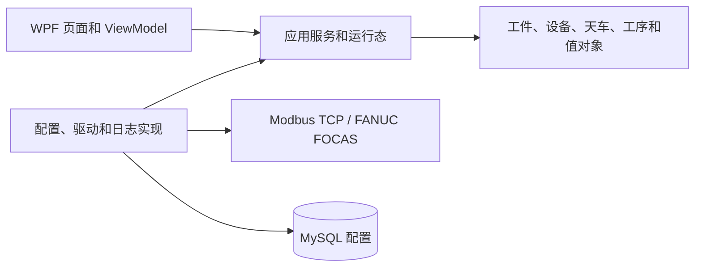

# 车间自动化调度系统架构

版本：3.6；核对日期：2026-10-14。本文描述当前源码实现，保留 §1～§18 编号，供源码 XML 注释引用。早期开发阶段规划、待确认草案和累积修订流水已移除。

## 1. 文档说明

源码入口为 [App.xaml.cs](../src/AutomatedLine.Ui/App.xaml.cs)。业务流程详见[应用层设计](应用层设计.md)，实际点位详见[通信与点位说明](通信与点位说明.md)，字段详见[数据字典](数据字典.md)。

## 2. 项目背景与目标

系统维护车间设备、天车及工件运行态，根据设备请求信号生成搬运候选，选择可执行天车，并执行取料、转运、放料和正常收尾。设备加工与 PLC 联锁由现场设备完成。

上位机自动运行与人工手动操作共用驱动；“启动线路”控制候选生成和任务派发，不等于向 PLC 写一个独立自动模式。

## 3. 需求与实际边界

### 3.1 物理产线

设备和天车数量来自数据库启用配置。同类型设备可以有多台；工序顺序由代码固定，停用某工序的全部设备可跳过该工序。

### 3.2 天车

每台车配置活动 X 范围、车宽、安全 X/Z、坐标偏移、速度及加减速。配置号 Id 标识资源，No 仅排序。覆盖源和目标设备 X 是选车条件。

### 3.3 功能范围

当前 UI 有主页面、天车管理、设备管理、工序展示、参数设置、大屏展示、报警处理、手动操作八页。运行服务包含设备采集、独立天车采集、候选生成、集中调度及每车执行循环。

### 3.4 数据边界

MySQL 只保存天车和设备配置。工件记录、状态、位置、队列、搬运任务、资源锁、活动报警只存在内存。日志单独落盘，不能自动重建工件运行态。

### 3.5 异常与现场责任

取料充磁调用前可保留工件重新派发；调用开始后按弃板处理。逻辑清理不代表实物已移走或车已到安全位置。PLC 信号真实性、联锁和异常后现场处理按现场约定执行。

## 4. 架构总览

UI 负责命令和展示；Application 定义抽象、流程与内存管理；Domain 定义业务对象；Infrastructure 实现通信、持久化、配置和日志。依赖注入组合位于 UI 启动代码。

## 5. 解决方案结构

| 项目 | 职责 |
|---|---|
| AutomatedLine.Domain | 工件、设备、天车、工序、线路状态、报警、XInterval |
| AutomatedLine.Application | 采集/生成/调度/Worker、handler、资源管理、异常协调及抽象 |
| AutomatedLine.Infrastructure | EF Core/MySQL、配置装载、Modbus/FOCAS 驱动、手动门面、文件日志 |
| AutomatedLine.Ui | .NET 8 WPF、CommunityToolkit.Mvvm、WPF-UI、XAML 页面 |
| AutomatedLine.Focas | FANUC SDK 封装 |
| AutomatedLine.Tests | 通信桩和领域/应用流程测试 |

解决方案通过 [Directory.Build.props](../Directory.Build.props) 统一使用 x86，以配合 Fwlib32.dll。

## 6. 领域模型

### 6.1 工件模型

`WorkpieceTask` 由 `WorkpieceInfo` 与 `WorkpieceRuntime` 组成。Info 保存板号、序号、尺寸、统一堵厚PlugThickness、堵孔、打印文字和斜床工艺；Runtime 保存任务状态、当前位置、当前工序及原始入线序号。

位置与任务状态相互独立：Paused 工件仍可以在设备上；Waiting 不等于一定在上料队列。源设备/天车的 CurrentWorkpiece 是关联引用，异常清理按工件 RuntimeId 核对。

### 6.2 设备模型

设备保存 Id、名称、类型、X 位置、尺寸能力、启用标志、最近信号快照及当前工件引用。设备 Y/Z 配置由搬运上下文查询，用于目标坐标。快照含采集时间、序号、连接/质量与点名值。

### 6.3 天车模型

天车静态配置与 Runtime 分离。Runtime 有 State、CurrentTask、LockedInterval；天车另有 CurrentWorkpiece。`IsIdle` 必须同时满足 Idle 和 CurrentTask=null。PLC共享状态保存在Application的CraneStateStore，包含读取时间、序号及失败结果，不混入Runtime；四处消费者经ICraneStateProvider查询有效快照，驱动动作确认继续实时读取。

### 6.4 搬运任务模型

`TransportTask` 表示一次源到目标搬运，独立 TaskId 关联 WorkpieceRuntimeId，并保存源/目标设备号及 X、目标工序、优先级。一个工件完成多道工序会经历多个搬运任务，两个 GUID 不可混为一谈。

大屏的执行阶段使用CraneRuntime.CurrentStep：Application在原步骤日志和有板检查时发布展示说明，UI只读。该字段不参与工艺判断，清CurrentTask同时清阶段；卡面任务工件按当前搬运关联总表，现场X11与内存持板分别显示，不新增PLC读取或联锁。

### 6.5 工艺路线模型

[ProcessRoute](../src/AutomatedLine.Domain/Routing/ProcessRoute.cs) 的固定顺序为：上料 → 双头镗 → 斜床 → 研磨 → 动平衡 → 打号 → 验点 → 下料。Forking 枚举存在，但不在固定路线中。

某工序是否参与只取决于是否存在对应类型的启用设备，不检查驱动、联网或握手。启用但不支持/不在线的设备会让该工序保留，不能理解成自动跳过。

### 6.6 路权区间值对象

[XInterval](../src/AutomatedLine.Domain/Spatial/XInterval.cs) 是 X 轴闭区间，自动规整端点；端点相接也冲突。任务区间为 `[min(源X,目标X)-车宽/2, max(源X,目标X)+车宽/2]`。接口支持安全余量，当前正常调用采用默认 0。

## 7. 运行时内存层

| 对象 | 保存内容 |
|---|---|
| RuntimeTaskManager | 工件列表、创建/启动/暂停/编辑/移除及 Changed 事件 |
| DeviceRegistry / CraneRegistry | 已装载的启用设备与天车领域对象 |
| DriverRegistry | 设备及天车驱动实例，分两个Id字典保存，同数字号不互相覆盖 |
| CraneStateStore / ICraneStateProvider | 按CraneId保存PLC快照及读取时间/驱动身份，只读接口查询有效状态 |
| CandidateTaskPool | 本轮全部候选，整体替换 |
| CraneTaskChannels | 每车容量 1 的待执行通道 |
| ResourceReservationManager | 设备号到搬运 TaskId 的预约 |
| RightOfWayManager | 搬运 TaskId 到 X 区间的锁 |
| ActiveAlarmStore | 可合并、可清空的活动报警 |

集合快照通常复制列表，元素仍是相同领域对象；不能把 Snapshot 当作深拷贝或全局事务快照。

## 8. 应用服务层

### 8.1 LineControlService

初始 Stopped。Start 置 Running；Pause 置 Paused；故障置 PausedByFault，并同步通知 UI。暂停阻止生成、派发和 Worker 领取新任务，不取消正在 await 的搬运流程，也不发送 PLC 急停。

State以volatile LineState后备字段提供跨线程可见读写，状态修改仍使用原锁；IsRunning每次比较该状态是否Running。这不把“检查运行”和随后派发/领取合并成原子操作，不能据此保证暂停瞬间已进入的轮次立即撤销。

### 8.2 DeviceStateCollector

后台循环对有驱动的设备并发启动读取，等待本轮全部完成后发布快照。每台 Modbus 设备内部按点顺序读；FOCAS 在专用线程顺序读宏。失败发布断开、Bad、空点表的快照，记录采集日志，通常不因此直接故障暂停。

### 8.2.1 CraneStateCollector 与 CraneStateStore

每台启用天车独立串行采集，读完立即发布，不等其他车；轮间等待默认500ms。失败替换旧成功结果，日志记录失败/恢复；目录新增或驱动替换由后续轮次跟进。停止宿主取消并观察全部循环。

缓存是Application唯一实例，整体发布不可变结果；以驱动身份隔离重载，单调时钟从读取开始计龄，最大年龄默认2000ms。未采集、失败、过期、停用或身份不符均不可用。大屏、手动页、调度和冷启动查询缓存，动作前后及运动轮询保持即时读取；详见[天车状态采集设计](天车状态采集设计.md)。

Publish以AddOrUpdate更新ConcurrentDictionary里的每车Entry；不写DeviceBase.Signals或数据库。GetSnapshot用于诊断最近结果，不检查年龄，业务消费用GetFreshStatus。地面设备采集通过OfType<IDeviceDriver>筛选后才写DeviceBase.Signals，两类资源的Id、对象、注册表与缓存各自独立。

### 8.3 TransportTaskGenerator

只处理 Waiting 工件。队列工件只允许最小 QueueOrder 的队头，选择第一个启用上料架；设备上的工件要求源设备引用一致、可读、未预约且请求下料。

目标须为下一参与工序、启用、已连接、未预约、尺寸符合、握手可接收且无已实现的设备报警。当前目标过滤没有单独的 CurrentWorkpiece=null 检查。每个可行目标生成一个候选，当前优先级均为 100。

没有下一参与工序时直接标记 Completed，因此不能将该状态等同于一定已搬到物理下料架。

### 8.4 CraneScheduler

候选池为空不整理选车数据，天车后台采集仍持续。否则查询启用且空闲车辆的有效缓存状态，再按优先级降序、最近可执行车到源的距离排序候选；未采集、失败或过期车辆不派发。

选车条件是启用、空闲、活动范围覆盖两端、状态非 null、HasAlarm=false；不额外过滤 HasPlate。按离源最近排序并预检查路权、预约，用 CAS 将工件 Waiting 改 Assigned，写车通道；写失败回 Waiting。此处尚未真正取得资源，也不设置车 Runtime 状态。

### 8.5 CraneWorker 与状态机

Worker 在宿主 StartAsync 按当时注册天车建立循环；每车串行执行。仅 Running 时领取通道任务，设置 CurrentTask/Reserved，调用状态机。

状态机入口先检查已接受的人工中止，再检查线路状态；已出队但入口发现未运行时关闭本次按钮入口、检查取消，复用Rollback保留设备与工件、回Waiting、清车任务/区间、Idle后返回，只记日志，不报警或升级故障暂停。检查发生在获取资源/PLC动作前，设备引用、信号、工件位置/工序/排位保持。

运行时初始化、查找工件和设备、创建上下文及获取资源都在try内。真正获取成功后置Running，再审核源、设速度、Pick、Transit、Place、Finish。普通任务异常处理后返回，车循环可以继续；宿主令牌取消时清理并重抛，终止循环。已通过入口的流程不因后续普通暂停被取消；该补充检查不清待领取通道，也不提供全线原子停发。

每次搬运的 CraneTaskExecution 拥有独立且关联宿主的令牌。手动页“中止当前任务”必须匹配车 ID 和 TransportTask.TaskId，仅中止已领取的当前搬运；立即故障暂停并取消该执行范围。状态机人工分支统一 Abort 弃板，Worker 捕获本次取消后继续存活；其他车当前流程及本车以后新令牌不受取消影响。中止与最终收尾提交串行判断，防止中止被正常完成状态覆盖。此入口不增加任何 PLC 急停、回安全位或清握手动作。

通道容量 1 限制待领取任务，不构成派发瞬间的车状态原子更新；车在 Worker 领取后才变 Reserved。不要将选车注释中的“派发立即置 Reserved”当作已实现代码。

### 8.6 ResourceReservationManager

一次 TryReserve 在内部锁内预约源与目标，失败不保留部分预约。到达目标并结束源握手复位后释放源预约，清理期间禁止其他任务取得该设备；完成或异常时按 TaskId 释放剩余预约。预约与 PLC 握手、电气互锁是不同机制。

### 8.7 RightOfWayManager

#### 8.7.1 路权单位

一项搬运任务持有一把区间锁，用源/目标设备 X 与车宽计算。当前算法没有把车当前位置、回 SafeX 的路径另加入初始区间。

#### 8.7.2 核心规则

TryAcquire 原子检查所有现有区间并登记；CanAcquire 只检查；Resize 与其他任务比对，失败保留旧区间；Release 幂等。路权与设备预约先后获取，整体并非一个事务，预约失败会释放刚取得的路权。

#### 8.7.3 到达目标后的更新

中转到达目标并结束源握手复位后缩为 `[目标X-车宽/2, 目标X+车宽/2]`。Resize 成功才同步 `crane.Runtime.LockedInterval`，大屏下一次刷新显示新区间；失败两处继续保留原区间。

#### 8.7.4 展示与释放

大屏读车 Runtime 的区间文本，不直接订阅管理器事件。正常回安全位后释放；异常协调器立即释放逻辑资源。空闲车没有任务区间锁。

### 8.8 AlarmManager

报警存入 ActiveAlarmStore，记录 alarm 日志并发布 Raised 事件。活动记录按等级、来源、内容合并并累加次数；Error/Critical 由 UI 弹框，Warning 不弹错误框。清活动报警不清 PLC 报警或日志。

异常窗口使用系统MessageBox，固定标题“线路异常（已暂停）”、错误图标和确定按钮。正文由异常详情、来源/资源、系统动作和时间拼接，不单列堆栈、次数或搬运Id；原文与触发分支详见[报警页面](页面布局/报警处理页面.md#21-异常弹窗固定格式)。该标题不替代实际Pause逻辑，窗口本身不改线路。首次配置装载失败先于弹窗订阅，只写列表/日志，不补弹；Warning级冷启动也不弹Error窗口。

### 8.9 TaskAbortCoordinator

`RecoverBeforeMagnet` 保留工件，`Abort` 弃板；两者都故障暂停、释放该任务资源、清车任务与路权显示、置车 Idle、记录报警。Abort 只清源/目标上与该工件身份一致的引用，保留任务记录便于追溯。

这两个方法没有移动天车、退磁或复位 PLC 握手的代码。其“清理”专指运行态。

### 8.10 ITransferHandler

注册上料架、双头镗、斜床、研磨机、打号机、下料架六种策略。Pick 处理源设备差异；Place 处理目标差异；ClearHandshakeAsync 定义该类型需要复位的输出握手。双头镗采用带托料架交互，三个请求输入与三个握手输出，取料充磁/放料退磁且Z回SafeZ成功后才发送完成，不使用中间卡钳握手；板长301、外径303、堵厚309分别按1/10/1倍率Convert.ToInt32后FC06写Word，主页面与弹窗使用统一堵厚。动平衡、验点、货叉尚无真实驱动/handler。

## 9. 基础设施层

### 9.1 驱动

[DriverFactory](../src/AutomatedLine.Infrastructure/Drivers/DriverFactory.cs) 按类型创建驱动。实体的 Protocol/Port 仍保存，但当前工厂忽略其值；实际固定端口和站号见[通信文档](通信与点位说明.md)。Modbus 请求内部超时抛 TimeoutException，真正调用者取消保持取消异常。设备 Modbus 超时取程序配置；天车客户端当前采用默认 3000ms。

### 9.2 数据库

EF Core/MySQL 映射 CraneConfig、DeviceConfig 两表，主键由使用方填写，天车 No 唯一；DeviceType 保存字符串。没有运行任务、报警或工艺顺序表。

### 9.3 配置

ConfigService 读写运行目录 appsettings.json 的 App 节点；ConfigurationLoader 从数据库装载启用资源并建立驱动。二者作用不同，参数保存不等于完整重启后台服务。

### 9.4 日志

FileAppLogger 按日期和类别记录 system、communication、collection、generation、scheduling、statemachine、task、alarm、operation 文件；具备保留期与滚动容量。高频等待原因按变化/抽样记录，日志没有出现某一轮不等于那轮没有执行。

## 10. 关键流程

### 10.1 正常任务流

创建 Created → 人工启动 Waiting → 生成候选 → 派发 Assigned → 执行 Running → 到目标更新位置/工序 → 回安全位 → Waiting 或 Completed。

### 10.2 派发时序

本轮读空闲车状态 → 候选排序 → 针对候选选车 → 预检查资源 → 工件状态 CAS → 写通道。真正加锁发生在下一阶段。

### 10.3 执行时序

取料完整成功后，源 CurrentWorkpiece 清空，车引用工件，位置改 OnCrane；放料完整成功后，目标引用工件，车引用清空，位置改 AtDevice，当前工序改目标工序。

中转到目标后先保持预约清源握手，结束后释放源预约、缩小并同步路权，再清目标握手。正常 Finish 移动到 `(SafeX,目标基础Y,SafeZ)` 后释放其余资源。

### 10.4 异常处理

#### 10.4.1 命令结果与取消分类

命令预期失败返回 CraneCommandResult；TransferContext 将 IsSuccess=false 转为异常，状态机按阶段统一处理。内部通信超时不再伪装为宿主取消。执行令牌取消时先区分人工中止和宿主停止：人工中止始终 Abort 弃板并保留 Worker；宿主停止按充磁边界清理后退出 Worker。未取消执行令牌的内部取消异常仍按普通故障处理。

状态机的取消令牌属于当前搬运，但由CreateLinkedTokenSource关联宿主；人工按钮和宿主停止都可能令其取消。异常分支用execution.Close在锁内关闭中止入口并返回人工标志，普通Exception也检查以处理动作故障与按钮并发。Worker外层使用宿主令牌判断是否退出；单次人工请求不取消宿主或未来新令牌。重复ClearRuntime幂等，FallbackAbort仅在还挂着CurrentTask时执行，正常状态机清理后不重复报警。完整路径见[应用层说明](应用层设计.md#511-两层取消判断与重复清理)。

#### 10.4.2 取料充磁调用前后

每种 Pick 在调用 MagnetOnAsync 前设置 MagnetCommandStarted=true。指令发出过程中失败、反馈读失败或反馈为 0，都属于调用后的弃板路径。标志不会在退磁后复原，因此放料及正常收尾异常仍弃板。

标志之前由共用CheckPlateBeforeMagnetAsync执行有板检查：原取料位等500ms读专用X11，明确0才仅Z相对补降，默认最多3次、每次5mm，补降成功后再等500ms重查。最多4次专用读取、15mm累计指令下降；任一次1才返回开始充磁。次数/步长可配，0次数关闭补降；读取失败、运动失败、取消及耗尽仍在充磁前，按原策略保留工件。X/Y不动，斜床偏移和五类handler业务顺序不改变。

StateMachine日志记录每次检查、准备/完成补降、单步/累计指令距离和实时显示/编码器位置。完整状态读取只用于位置诊断，不用缓存判定X11；读不到位置记未知，诊断失败不改变专用读板结果，调用者取消仍传播。指令量和实测坐标分列，不把到位容差或下压结果当作精确下降距离。配置与日志样例见[应用层补降说明](应用层设计.md#541-取料无板的有限补降与日志)。

调用前异常保留源工件引用、位置、工序、入线序号，状态回 Waiting。两类异常均暂停全线并报警；现场完成处理后重新启动，可重新生成保留工件的候选或执行其他工件。

### 10.5 冷启动核对

App打开、宿主启动并等待约700ms后执行一次；主页面每次点击启动线路都再执行，包括暂停后恢复，并不要求整个内存任务表为空。

天车部分并发等待有效且X11已知的共享快照，最多Collection.CommunicationTimeoutMs；超时记录该车核对未完成，不把未知当无板，也不新增开线阻塞。设备部分仍读取Device.Signals。

设备有料信号或天车 X11 有板、但无内存工件引用时记录 Warning。它不创建工件、不恢复身份、不设置资源隔离状态，也不阻止 Start。报警提示中“将不参与调度”不能替代实际选车过滤条件。

因此它不是单纯Console日志，还会新增活动报警、写alarm日志，并可能等待缓存；不清信号/锁、不移动天车、不禁用资源。无内存身份的残留板不会生成候选，对应车是否接其他任务仍按正常选车条件判断。

## 11. 状态定义

| 枚举 | 当前值及说明 |
|---|---|
| LineState | 0 Stopped、1 Starting、2 Running、3 PauseRequested、4 Paused、5 PausedByFault；当前服务直接使用 0/2/4/5，1/3 为保留值 |
| WorkpieceState | 0 Waiting、1 Assigned、2 Running、3 Completed、4 Discarded、5 Created、6 Paused |
| CraneState | 0 Idle、1 Reserved、2 Running |

ResourceState 枚举仍存在：Available=0、Reserved=1、Busy=2、Alarm=3、Disconnected=4、BlockedByPhysicalState=5。设备行 ViewModel 根据连接、Alarm 点、预约和工件引用派生显示状态；领域设备没有持续写入的 ResourceState 字段，BlockedByPhysicalState 当前未实现隔离流程。没有 TransportTaskState 枚举。

## 12. 线程与周期模型

### 12.1 逻辑循环

设备采集、天车采集、候选生成、调度随宿主运行；天车采集与Worker分别每车一个循环；UI RuntimeTicker每秒应用缓存。FOCAS每通道专用线程调用SDK。天车共享采集与即时动作读取仍复用原通信连接，不提供硬实时优先级保证。

采集更新字典不会直接推送页面属性。大屏与手动页各自订阅1s UI节拍，查询同一缓存、给自己的ViewModel赋值，再由PropertyChanged/集合通知更新WPF；切车时手动页立即应用缓存。修改采集周期不改变UI固定节拍，手动页自动更新无需反复点击刷新。

### 12.2 周期可配置

设备/天车采集、生成、调度、Worker等待周期默认500ms，服务启动读取并最低限制为50ms；天车快照最大年龄默认2000ms，每次查询读取。实际间隔还包含本轮执行耗时，不能解释为严格 2Hz。通信、到位、握手超时和 UI 节拍是不同时间约束。

### 12.3 并发保护范围

资源管理器内部锁、工件状态 CAS、每车串行执行及每连接通信锁负责各自边界；没有覆盖领域对象全部字段的全局事务。手动页面没有自动运行互斥，多个调用方可以在两次独立 PLC 请求之间交错。

## 13. 页面设计

| 小节 | 页面与文档 |
|---|---|
| 13.1 | [主页面](页面布局/主页面.md)：线路总控、工件列表、启动/暂停/删除 |
| 13.2 | [天车管理](页面布局/天车管理页面.md)：数据库天车配置 CRUD |
| 13.3 | [设备管理](页面布局/设备管理页面.md)：设备配置 CRUD |
| 13.4 | [工序展示](页面布局/工序展示页面.md)：固定路线与启用设备数 |
| 13.5 | [参数设置](页面布局/参数设置页面.md)：分类弹窗编辑 App 参数 |
| 13.6 | [大屏展示](页面布局/大屏展示页面.md)：设备/天车卡片、候选与执行中任务 |
| 13.7 | [报警处理](页面布局/报警处理页面.md)：活动报警与清空 |
| 13.8 | [手动操作](页面布局/手动操作页面.md)：天车状态、命令与设备握手复位 |

## 14. 配置与数据库设计

### 14.1 appsettings.json 分类

App 下有 Collection、Scheduling、Crane、Transfer、StateMachine、Logging 六类；ConnectionStrings 单独提供数据库连接。配置默认值、生效时机及无敏感信息示例见[配置说明](配置与运行说明.md)。

参数页“采集”现有四项，包括CraneIntervalMs和CraneSnapshotMaxAgeMs。卡片Categories和编辑窗Items通过XAML动态绑定生成，不要求每个新字段手写控件。最大年龄在配置文件重载后的查询中生效，采集周期在服务启动时读取。

“状态机”也有四项：HandshakeTimeoutMs、ExecuteIntervalMs、PickPlateRetryCount（默认3）、PickPlateStepMm（默认5）。补降参数由新搬运上下文取得，检查开始后不随文件重载改变；五类自动取料共用，手动充磁和放料不使用。

### 14.2 MySQL 配置表

字段与 EF 约束见[数据字典](数据字典.md)。Id 是资源关联键，No 不是天车号。Protocol/Port 的保存值当前不会改变固定驱动协议/端口。

### 14.3 配置变更操作规程

管理页只拦截 Running 状态下的 CRUD。暂停不会立刻终止在途任务；保存/删除会重装两类资源注册表和驱动、清待领取通道，保留通道实例，但不重建 Worker 或重置全部运行态。

因此应先让在途任务结束并完成现场处理，再变更配置并重启进程。直接改数据库只在下次装载后读取；再次点击“启动线路”不会重新读表，也不会重建车循环。重启会丢失内存工件，现场与内存需重新建立一致关系。

## 15. 启动与关闭的实际实现

App 先 LoadAsync 装载配置，再启动宿主后台服务。装载失败会记录系统错误报警，UI 仍可能打开。启动后等待约 700ms 再执行冷启动核对，该延时不能保证所有设备已完成首轮采集；天车核对另外有界等待共享快照。

Worker 循环只在宿主 StartAsync 建立；没有运行期自动监督/重建。StopAsync 取消宿主执行，逐个通过 WhenAny 等待车循环或停止令牌对应等待任务，未再 await 车循环观察最终异常；重新启动线路是线路状态操作，不等于宿主重新启动。

## 16. 已实现能力与扩展边界

### 16.1 工序与驱动扩展

固定路线中动平衡和验点有枚举/领域类型，但当前无真实驱动和取放 handler；货叉也无实现且未进入固定路线。要加入生产流程需同时补驱动、点位、候选握手规则、handler、页面显示，不能只启用数据库一行。

### 16.2 运行恢复

当前支持本进程内暂停后继续派发及异常后的新任务消费；没有跨进程恢复工件、原任务断点续跑或仅凭 PLC 有板信号恢复板号的机制。

## 17. 当前运行约束

1. 工件任务状态与位置独立，候选仅处理 Waiting；Queued/OnDevice 不能仅靠状态猜测。
2. 一次搬运使用独立 TaskId；设备预约和路权按此 ID 释放。
3. 每车 Worker 串行执行；正式执行前再次获取资源，预检查成功不保证最终获取成功。
4. 内存交接在整个 Pick/Place 成功后发生，不能用充退磁反馈单独代表全部交接已完成。
5. 暂停不取消当前流程；清报警不自动开线；删除任务不处理实物。
6. 异常分流由取料充磁调用标志决定，不按 HasPieceOnCrane、位置或异常类型猜测。

## 18. 路权完整示例

源 X=5000、目标 X=18000、车宽=400：执行开始取得 `[4800,18200]`，同时预约源和目标。

另一任务申请 `[10000,16000]` 会因相交失败，回 Waiting 等后续派发。首车到达目标并结束源握手复位后释放源预约，Resize 成功变 `[17800,18200]` 并同步车 Runtime；第二任务此时可重新争取其区间。

首车放料后正常回安全位，再释放剩余预约和区间。若发生异常，协调器立即清逻辑资源并暂停线路；物理恢复按现场步骤完成。
